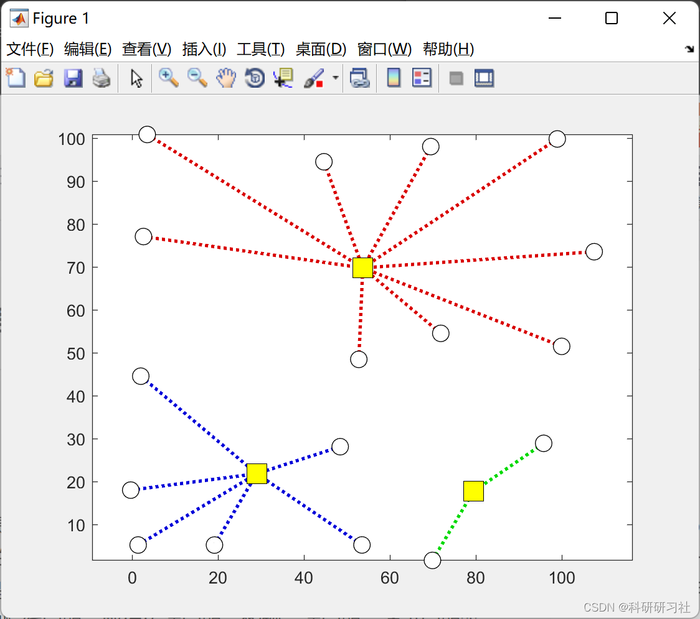
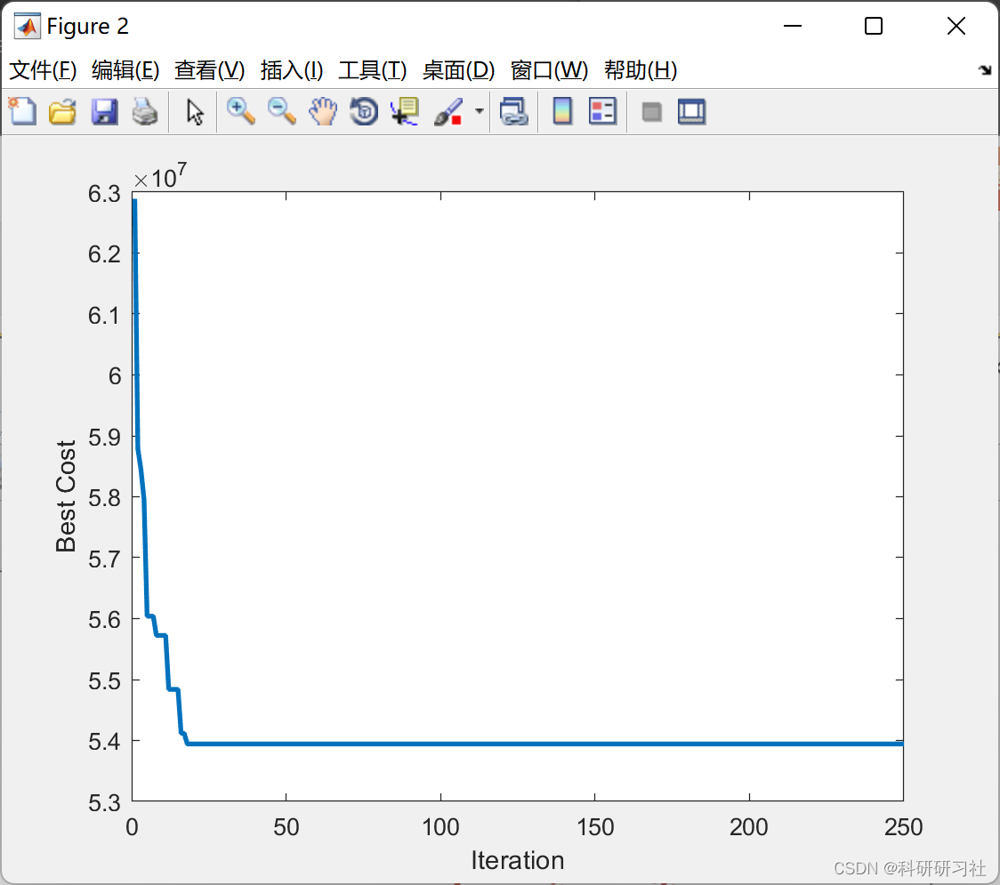
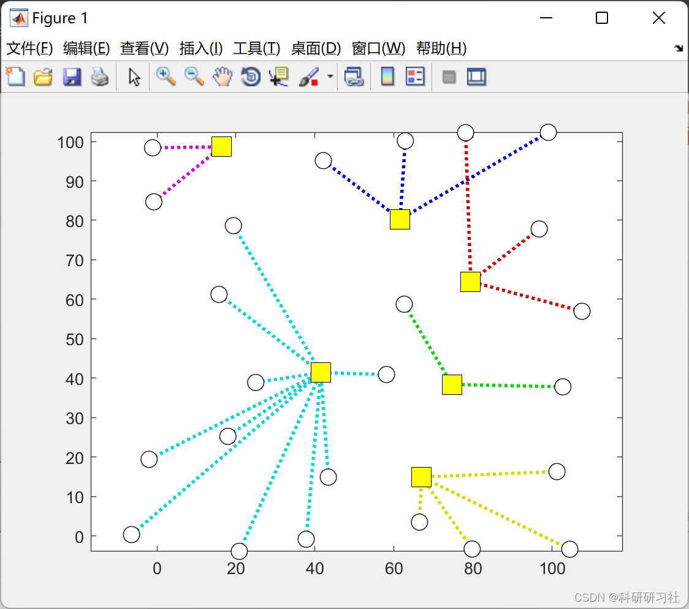
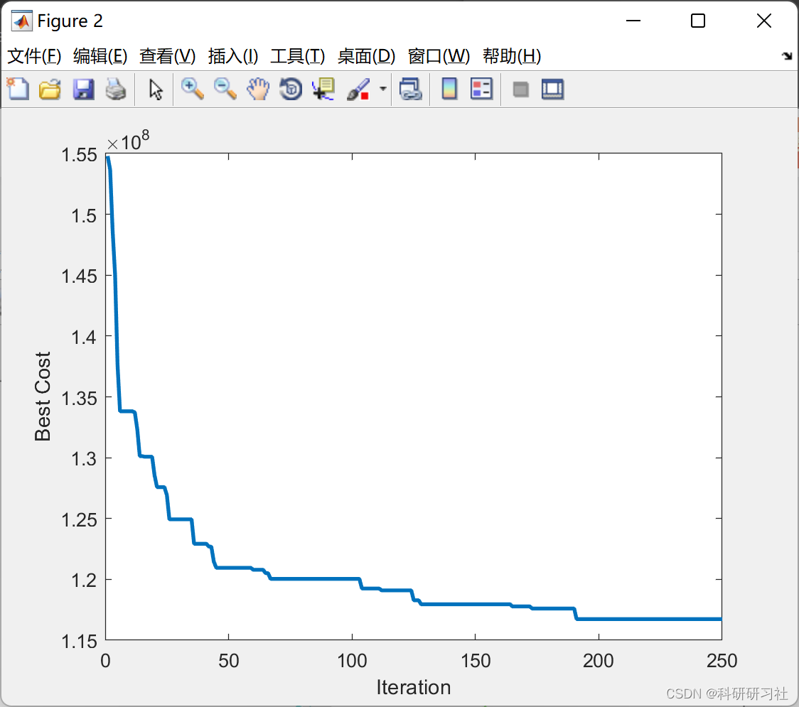
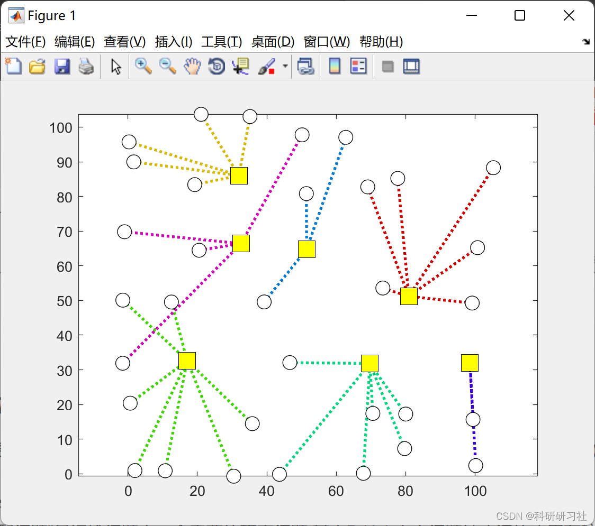
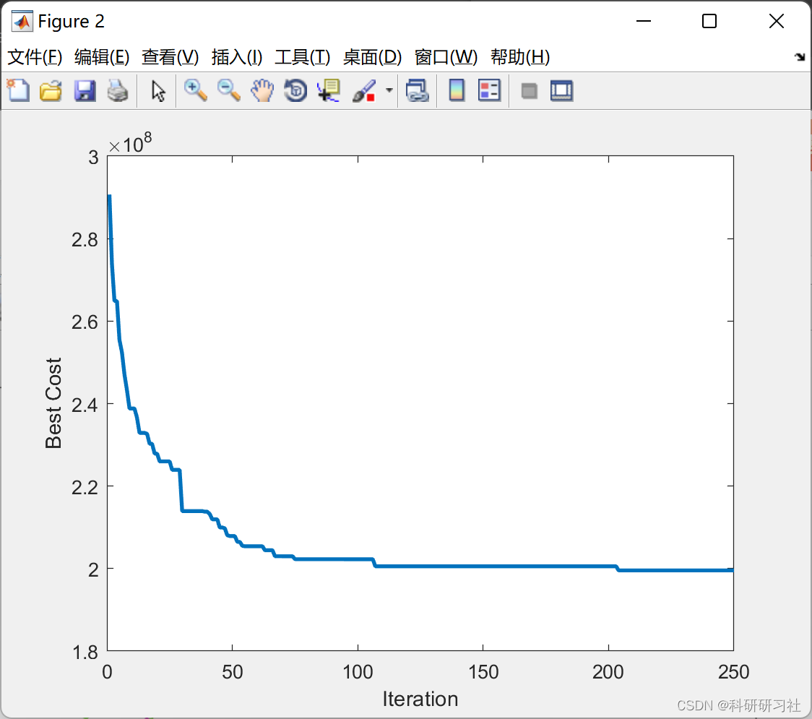

# Particle Swarm Optimization Algorithm-Based p-Hub Site Allocation Optimization (Matlab Code Implementation)

1. Overview
The issue of location allocation in the P-Hub center problem originated from the Civil Aviation Administration of the United States (CAB), where airlines' flight routes are structured as an axis-and-spoke system, with a primary airport serving as the hub (hub) and numerous routes radiating outward from it as spokes (spoke). The main airport acts as a transfer point, thereby facilitating the transfer of passengers and cargo. Among these, the P-Hub center problem is one such example, which has been widely applied in real life, such as route problems, mail delivery issues, cargo transportation problems, communication issues, etc.
2. Matlab Code and Details
This article only showcases part of the code, and for the full code and detailed explanation, please click the link:
P-Hub Location Optimization Based on Particle Swarm Optimization Algorithm (Matlab Code Implementation)
\nfunction sol=ParseSolution(xhat,model)\n\n    N=model.N;\n    P=model.P;\n    c=model.c;\n    alpha=model.alpha;\n    f=model.f;\n    r=model.r;\n\n    xii=diag(xhat)';\n    \n    if any(xii>=0.5)\n        \n        [~, so]=sort(xii,'descend');\n        \n        nHub=0;\n        for i=so\n            if xii(i)<0.5 || nHub>=P\n                break;\n            end\n            \n            xii(i)=1;\n            \n            nHub=nHub+1;\n        end\n        \n        xii(xii<1)=0;\n        \n    else\n        \n        [~, imax]=max(xii);\n        \n        xii(:)=0;\n        xii(imax)=1;\n        \n    end\n    \n    Hubs=find(xii==1);\n    \n    x=xhat;\n    for i=1:N\n        if xii(i)==0\n            x(i,:)=0;\n        else\n            x(:,i)=0;\n            x(i,i)=1;\n        end\n    end\n    \n    h=zeros(1,N);\n    for i=1:N\n        \n        XI=x(:,i);\n        XI(xii==0)=-inf;\n        \n        [~, h(i)]=max(XI);\n        \n        x(:,i)=0;\n        x(h(i),i)=1;\n        \n    end\n    \n    oc=zeros(N,N);\n    for i=1:N\n        for j=1:N\n            if i==j\n                oc(i,j)=0;\n            else\n                k=h(i);\n                l=h(j);\n                oc(i,j)=c(i,k)+alpha*c(k,l)+c(l,j);\n            end\n        end\n    end\n    \n    ocr=oc.*r;\n    SumOCR=sum(ocr(:));\n    \n    xiif=xii.*f;\n    SumXF=sum(xiif);\n    \n    TotalCost=SumOCR+SumXF;\n    \n    sol.x=x;\n    sol.h=h;\n    sol.Hubs=Hubs;\n    sol.SumOCR=SumOCR;\n    sol.SumXF=SumXF;\n    sol.TotalCost=TotalCost;\n\nend\n  
3. Running Results
3.1 Example 1 Editing
Editing
3.2 Example 2 Editing
Editing
3.3 Example 3 Editing
Editing
4. References
[1] Zhuo Yueming, Fan Xiaobing. Optimal Solving of P-Hub Center Problem Based on SOFM. Journal of Jishou University: Natural Science Edition, 2009(5):60-63  
Institution: School of Physics and Information Engineering, Jishou University
Abstract: The "Location-Allocation Problem" is an important research issue in transportation problems, where the P-Hub center problem is widely applied to aerospace, communication, and mail delivery issues. Currently, many heuristic methods have been widely used to find the optimal solution, such as genetic algorithms, simulated annealing, and Hopfield networks; this study proposes a self-organizing feature map network solving method based on artificial neural networks for known customer and service center numbers. It utilizes the self-learning function of neurons to identify the optimal location of the service center.

## Images

<!-- PAYMENT_BLOCK -->

## Get this dataset

- Payment link (Stripe): [Buy now](https://buy.stripe.com/3cs8yP7sY87d0vu9AB)
- Payment QR code: 

<!-- /PAYMENT_BLOCK -->
